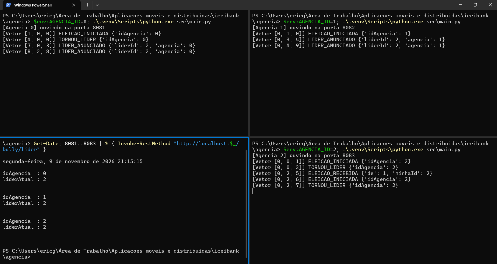
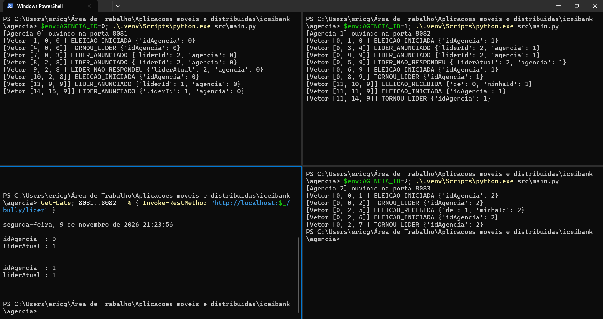
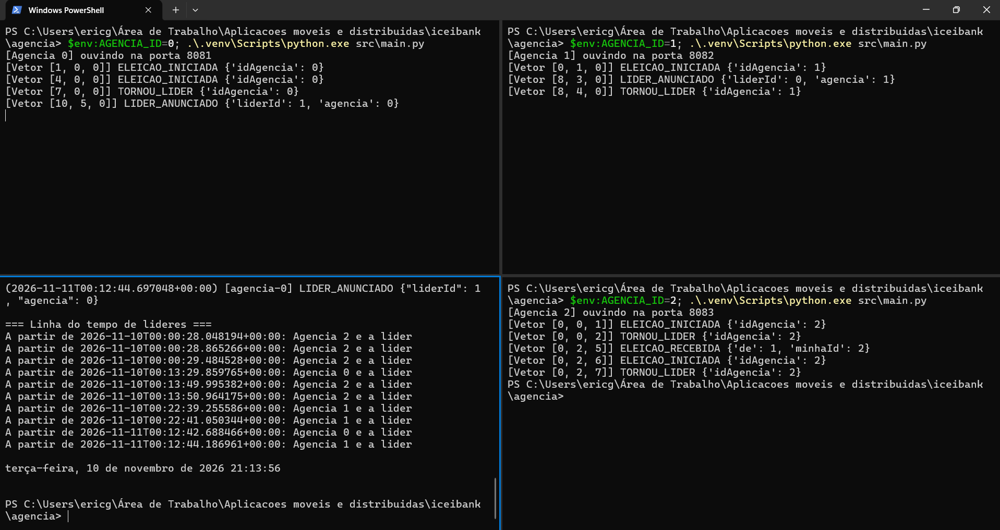
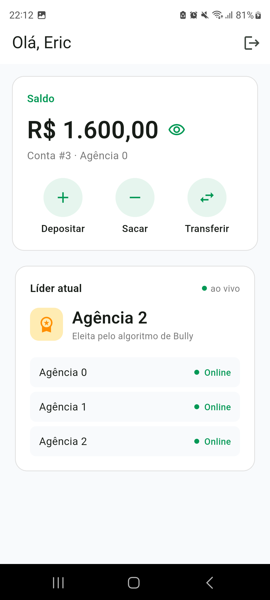
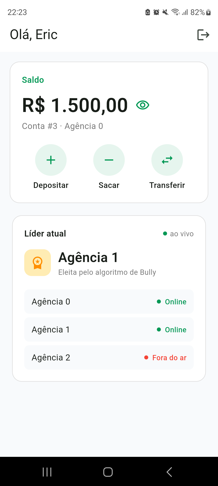
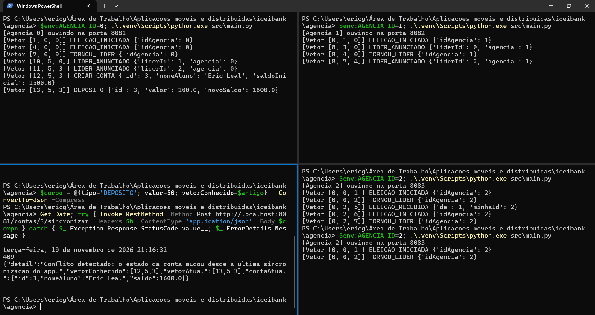
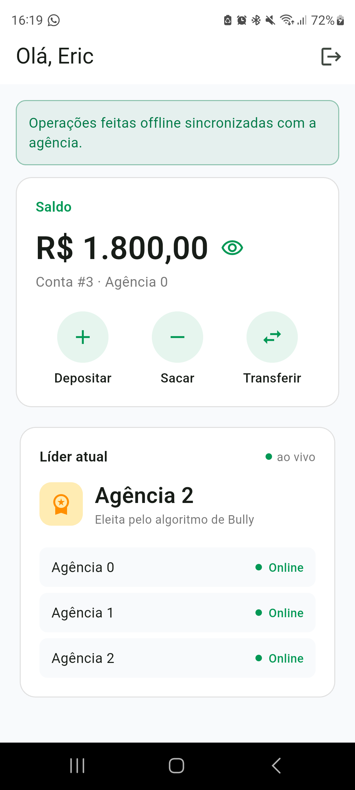
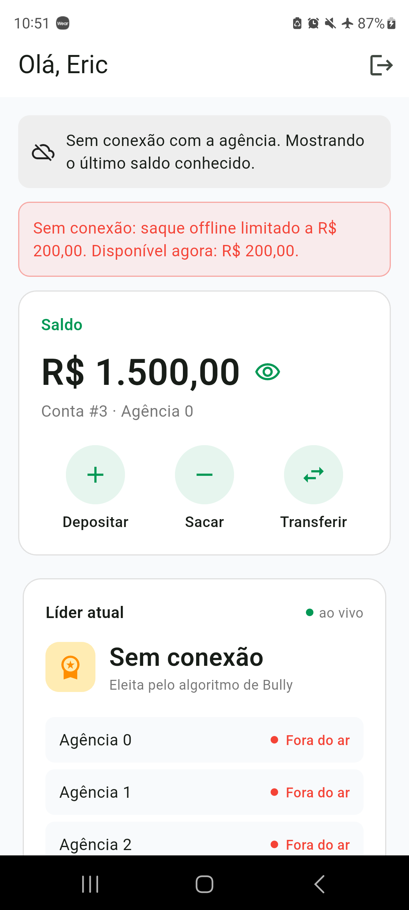

# RESPOSTAS (ICEIBank - Sprint 3)

## Parte A (Mensagens de eleição e coordenador)

1. **Por que o algoritmo de Bully sempre elege o processo de maior ID, e não o de menor? O resultado seria diferente (mas ainda assim correto) se a regra fosse invertida?**

   **Resposta:** Maior ID é só uma convenção. O que o algoritmo precisa é de uma ordem total entre os processos que todos conhecem e respeitam do mesmo jeito, para que exista um único vencedor possível entre os ativos.

   Se a regra fosse invertida, a eleição mandaria mensagens para os IDs menores e a agência 0 seria a líder sempre que estivesse no ar. O resultado seria outro processo, mas continuaria correto: todas as agências concordariam com a mesma líder. O que não pode é cada agência usar uma regra diferente.

2. **No passo 4 da tarefa, você deve ter visto mais de uma agência declarar `TORNOU_LIDER` durante a subida, antes de convergir. Isso é um bug, ou um comportamento esperado do algoritmo? Justifique com base no que você observou nos logs.**

   **Resposta:** É esperado. Na minha subida o `historico_lideranca.py` mostrou a agência 2 declarando `TORNOU_LIDER` três vezes em menos de um segundo:

   ```
   A partir de 2026-11-02T16:19:27.349323+00:00: Agencia 2 e a lider
   A partir de 2026-11-02T16:19:27.869457+00:00: Agencia 2 e a lider
   A partir de 2026-11-02T16:19:28.270331+00:00: Agencia 2 e a lider
   ```

   Cada agência abre uma eleição assim que sobe. A agência 2 não tem ninguém acima dela, então vira líder na primeira eleição. Depois chegam as eleições das agências 0 e 1, e pela regra do algoritmo quem recebe uma eleição de um ID menor responde e abre a própria eleição. A agência 2 abre de novo, de novo não encontra ninguém maior e anuncia de novo. São anúncios repetidos, não líderes diferentes, e no fim as três concordam: `liderAtual: 2`.

   Na rodada dos prints a ordem de subida foi outra e apareceu mais um caso: a agência 0 subiu sozinha, não achou ninguém acima e se declarou líder por alguns segundos. Quando a 2 subiu, ela assumiu e as outras aceitaram.

   

3. **O endpoint `/bully/eleicao` não tem nenhuma autenticação. Qualquer processo que descubra a URL de uma agência pode disparar uma eleição nela. Isso é um problema de segurança real para este projeto? Por quê, ou por que não?**

   **Resposta:** Neste projeto o risco é baixo: as agências rodam em `localhost` e a líder ainda é só informativa, nenhuma operação de dinheiro depende dela.

   Num sistema real seria um problema, e o `/bully/coordenador` é ainda pior que o `/bully/eleicao`. Disparar eleições em loop só gera tráfego e instabilidade. Já um `POST /bully/coordenador` falso faz a agência aceitar qualquer `liderId` sem conferir nada. Quando a líder passar a coordenar transações no Sprint 4, isso deixaria alguém de fora decidir quem coordena o dinheiro. A correção seria autenticar as chamadas entre agências, por exemplo com um segredo compartilhado ou mTLS, separado do JWT dos clientes.

## Parte B (Heartbeat e failover automático)

1. **O que aconteceria se o intervalo do heartbeat (`intervaloMs`) fosse muito curto (ex.: 100ms)? E se fosse muito longo (ex.: 60 segundos)?**

   **Resposta:** Com 100ms, cada agência faria 10 verificações por segundo na líder. A falha seria detectada quase na hora, mas a rede e a líder ficariam ocupadas só respondendo heartbeat, e qualquer atraso pequeno da rede seria confundido com queda, disparando eleições sem necessidade.

   Com 60 segundos, a rede quase não seria usada, mas o sistema poderia passar até um minuto achando que tem uma líder que já morreu. Os 3 segundos usados aqui ficam no meio: no meu teste, a nova líder apareceu em menos de 8 segundos depois de derrubar a agência 2.

   

2. **No passo 6 da tarefa, a agência que você derrubou e subiu de novo pode, dependendo do ID dela, "tomar" a liderança de volta mesmo que a eleição atual estivesse funcionando bem. Isso é desejável? Que problema prático isso pode causar em um sistema real?**

   **Resposta:** Foi o que aconteceu no meu teste: derrubei a 2, a 1 assumiu, e quando a 2 voltou ela abriu uma eleição e retomou a liderança. Funciona, mas não é desejável. A troca não traz ganho nenhum, porque a agência 1 estava liderando bem.

   O problema prático é a troca acontecer no meio de uma operação coordenada pela líder. Se a agência 1 estivesse conduzindo um commit em duas fases e perdesse a liderança no meio, a transação poderia ficar sem ninguém para decidir o resultado, com contas bloqueadas esperando. Uma agência instável que cai e volta várias vezes ainda causaria uma troca de liderança a cada volta. Algoritmos como o Raft evitam isso: quem volta entra como seguidor e não toma a liderança de quem está funcionando.

3. **O `TIMEOUT_MS` de 1 segundo é usado tanto para detectar uma agência fora do ar quanto para decidir se alguém respondeu a uma eleição. O que aconteceria se a rede estivesse genuinamente lenta?**

   **Resposta:** A agência confundiria lentidão com queda. No heartbeat, ela registraria `LIDER_NAO_RESPONDEU`, esqueceria a líder e abriria uma eleição sem necessidade. Na eleição, ela trataria a agência maior como fora do ar e se declararia líder.

   No meu código isso pode até inverter a liderança. Se a agência 1 achar que a 2 caiu, ela vira líder e manda `/bully/coordenador` para todas, inclusive para a 2, que está viva. O `receber_coordenador` aceita o anúncio sem comparar IDs, então a 2 passa a considerar a 1 como líder. Como a líder não verifica ninguém no heartbeat, isso só se desfaz quando alguma agência reiniciar.

   Isso aconteceu de verdade numa das subidas, sem rede lenta: a agência 1 se declarou líder antes de a 2 terminar de subir e avisou a 2, que aceitou. As agências 0 e 1 respondiam `liderAtual: 2`, mas a própria agência 2 respondia `liderAtual: 1`. A correção é a agência ignorar um anúncio de coordenador com ID menor que o dela e abrir uma eleição. Um timeout maior ou várias falhas seguidas antes de declarar a líder morta reduziriam esses alarmes falsos.

## Parte C (Observando a eleição)

1. **Observando a saída do script, quantas vezes a liderança mudou de mãos durante a "tempestade" de eleições da subida inicial (Parte A), antes de estabilizar? Isso tem algum custo real para o sistema?**

   **Resposta:** A liderança não chegou a mudar de mãos: foram três declarações `TORNOU_LIDER`, todas da agência 2, em menos de um segundo. Depois disso a linha do tempo só muda quando eu derrubo a 2 (a 1 assume) e quando ela volta (a 2 retoma).

   

   Mesmo sem trocar de líder, a tempestade tem custo. Cada eleição repetida gera mensagens de eleição para as agências maiores e um anúncio de coordenador para todas as outras, e cada uma dessas mensagens avança o relógio vetorial e escreve no log. Com 3 agências é pouco, mas o número de mensagens cresce com o quadrado do número de processos, e durante esse período cada agência pode responder `/bully/lider` com um valor diferente.

## Parte D (App Flutter)

1. **Como o app decide com que frequência consultar `/bully/lider`? Que trade-off você considerou ao escolher esse intervalo?**

   **Resposta:** O app consulta a cada 3 segundos (`_intervalo` em `painel_lideranca.dart`), o mesmo intervalo do heartbeat entre as agências. Consultar mais rápido não adianta: as próprias agências só percebem a queda da líder depois de um heartbeat.

   Cada rodada são 3 requisições pequenas, uma por agência, com timeout de 1,5s. O `Timer` é cancelado no `dispose` do painel, então quando a pessoa sai da tela inicial o app para de consultar e não gasta bateria nem dados à toa.

   Além da líder, o painel mostra quais das três agências responderam na última rodada ("Online" ou "Fora do ar"). Isso sai da mesma consulta e deixa o failover visível no celular:

   

   

2. **Se, num momento de transição, você consultasse duas agências diferentes e elas respondessem líderes diferentes, como seu app se comporta? Isso é um problema real, ou se resolve sozinho na próxima consulta?**

   **Resposta:** O app consulta as três agências em paralelo e, se as respostas divergirem, mostra a resposta da agência de maior ID que respondeu. É uma escolha simples, não garante a resposta certa durante a transição.

   Não é um problema real enquanto a líder for só informativa. A divergência dura no máximo o tempo de uma eleição, e na próxima consulta, 3 segundos depois, as agências já concordam e o painel se corrige sozinho.

3. **Compare a arquitetura do app Flutter com a do frontend web do Sprint 1: o que foi reaproveitável e o que precisou ser pensado de forma diferente?**

   **Resposta:** Reaproveitei os conceitos do `frontend/src/services/api.ts`:
   - uma camada única de API que injeta o token e traduz os erros (`detail` da FastAPI) em mensagem legível;
   - o 401 derrubando a sessão e voltando para o login;
   - a regra de particionamento `id % 3` para mostrar se a transferência é local ou entre agências;
   - o `idOperacao` gerado quando a tela abre, para a transferência ser idempotente.

   O que mudou por ser mobile:
   - **Endereço:** dentro do emulador, `localhost` é o próprio celular, então o app acessa o PC por `10.0.2.2`. O endereço vem de `--dart-define=HOST=...`: os prints foram tirados num celular real ligado por USB, com `adb reverse` levando o `localhost` do celular até as agências no PC, porque a rede Wi-Fi não deixava os dois aparelhos se enxergarem.
   - **Rede:** não existe CORS, mas o Android bloqueia HTTP sem TLS por padrão, então liberei no `AndroidManifest.xml`.
   - **Sessão:** o token fica no `shared_preferences` no lugar do `localStorage`.
   - **Telas:** valor de depósito e saque numa janela que sobe de baixo, e o saldo atualiza ao puxar a tela.
   - **Conexão:** a principal diferença é tratar a falta de conexão como normal, o que no web eu não precisei fazer (Parte F).

## Parte E (Sincronização offline-first no backend)

1. **Por que a agência compara o vetor inteiro, e não só verifica se o saldo da conta mudou? O que a comparação de vetores detecta que uma simples comparação de saldo não detectaria?**

   **Resposta:** Porque saldo igual não quer dizer que nada aconteceu. Um depósito de 100 seguido de um saque de 100 deixa o saldo igual, mas a conta passou por duas operações que o app não viu. A comparação de saldo deixaria passar; a de vetores pega, porque cada operação avança o vetor e ele nunca volta.

   O vetor também diz a relação entre os estados: se o vetor do app é anterior ao da agência, a agência sabe que o app está desatualizado, e não só que os números são diferentes.

   No print, o app conhecia `[12,5,3]`, um depósito de 100 feito direto na API levou a agência para `[13,5,3]`, e a sincronização do depósito de 50 foi recusada com 409. O `contaAtual` mostra o saldo de 1600, sem os 50:

   

2. **Qualquer mudança no vetor da agência é tratada como conflito. Explique por que essa simplificação existe e o que seria necessário para tornar a detecção mais precisa, por conta.**

   **Resposta:** A simplificação existe porque o relógio vetorial é da agência, não da conta. Ele avança em qualquer evento local ou mensagem recebida, e a agência não guarda qual posição do vetor tocou qual conta.

   Nos meus testes isso fica claro: a posição 2 do vetor da agência 0 estava em 11 sem nenhuma operação bancária vinda da agência 2. Esses avanços são mensagens do Bully (`ELEICAO_RECEBIDA`, `LIDER_ANUNCIADO`). Então uma simples reeleição, sem mexer em dinheiro, já faz uma operação offline ser recusada com 409.

   Para ficar preciso por conta, cada conta precisaria da sua própria versão: um contador por conta que só avança em operações daquela conta. O app guardaria essa versão e a sincronização compararia só ela.

3. **Quando a sincronização é recusada (409), o que o app deveria fazer com essa informação: descartar, tentar de novo automaticamente, ou perguntar à pessoa usuária?**

   **Resposta:** Escolhi perguntar. Para um banco, aplicar de novo sozinho seria o mesmo que ignorar o conflito, e descartar sozinho faria a pessoa perder uma operação sem saber. Quem sabe se o depósito ainda faz sentido com o saldo novo é ela.

   O app usa o `contaAtual` e o `vetorAtual` que vêm no 409 para atualizar o cache e mostrar o saldo real. A operação fica marcada em vermelho com dois botões: "Descartar" e "Reenviar", que reaplica a operação sobre o estado atual (detalhes na Parte F).

## Parte F (App Flutter - modo offline-first)

1. **Qual biblioteca de armazenamento local você escolheu, e por quê? Quais alternativas você considerou?**

   **Resposta:** Usei o `sqflite`, com duas tabelas: `contas`, com o último saldo e vetor conhecidos, e `pendentes`, com a fila de operações. A fila precisa de ordem e de alterar uma linha específica (trocar o vetor, marcar como conflito), e com SQL isso é direto: `ORDER BY id` com chave autoincremental e `UPDATE ... WHERE id = ?`.

   Considerei:
   - **`shared_preferences`:** já uso para o token, mas é só chave-valor; guardar a fila seria serializar uma lista inteira a cada mudança.
   - **`Hive`:** mais simples de usar, mas a ordem e as consultas por conta eu teria que montar à mão.
   - **`Drift`:** oferece SQL tipado, mas exige geração de código, o que era peso demais para duas tabelas.

2. **Na tarefa 5, o que exatamente aconteceu na tela do app quando a sincronização foi recusada?**

   **Resposta:** Fiz um depósito de 50 com o emulador em modo avião e, antes de reconectar, um depósito de 100 direto na API. Ao desligar o modo avião, sem eu tocar no app, ele tentou sincronizar e recebeu 409:
   - o depósito apareceu em vermelho, com a mensagem "Não aplicado: Conflito detectado...";
   - logo abaixo, "Saldo real na agência: R$ 1.800,00";
   - os botões "Descartar" e "Reenviar";
   - o saldo do topo voltou a ser o real, sem o selo "pendente".

   Fechei e reabri o app e o conflito continuava lá, porque fica salvo no SQLite. Ao tocar em "Reenviar", o app trocou o vetor da operação pelo vetor atual e sincronizou: o saldo foi para R$ 1.850,00.

   Escolhi assim pelo motivo da Parte E: num app de banco, a pessoa precisa ver o que mudou e decidir. Uma estratégia automática esconderia exatamente a informação que o 409 existe para mostrar.

   Na rodada dos prints, no celular real, o caminho sem conflito também foi testado. Com o modo avião ligado, o depósito de 200 foi para a fila e o saldo virou provisório:

   

   Ao reconectar, sem tocar no app, a fila foi enviada e o saldo voltou a ser o confirmado:

   

   Um caso que eu não tinha previsto: fiquei offline por mais de 30 minutos, o JWT expirou e a sincronização voltou com 401. O app fez logout e marcou o depósito como "Não aplicado: Token expirado". A operação não se perdeu, porque a fila fica no SQLite, mas depois do login ela precisou de um "Reenviar" manual. O ideal seria o app reenviar sozinho os itens recusados por 401 depois de um novo login.

3. **UI otimista significa mostrar o resultado esperado antes de ter certeza de que ele vai acontecer. Que risco isso traz para um aplicativo bancário? Como seu design tenta reduzir esse risco?**

   **Resposta:** O risco é a pessoa agir com base num dinheiro que ainda não existe. Ela vê um depósito offline somado ao saldo e conta com ele, mas o depósito pode ser recusado por conflito. Ou faz um saque offline que depois falha por saldo insuficiente, porque o saldo real mudou enquanto ela estava desconectada.

   Para reduzir:
   - quando há fila, o saldo aparece como "Saldo provisório" com o selo "pendente", nunca como saldo confirmado;
   - as operações pendentes ficam listadas embaixo do saldo, com o aviso "Será enviado automaticamente";
   - o aviso de sem conexão diz que o valor é o último conhecido;
   - só depósito e saque entram na fila; transferência offline dá erro, porque mexe em duas contas e possivelmente em duas agências;
   - saque offline tem limite (funcionalidade adicional, abaixo), então o tamanho do erro possível fica limitado;
   - se algo for recusado, a operação sai do saldo provisório e o saldo volta ao real.

## Funcionalidade adicional (seção 2.1)

**Limite para operações offline.** Sem conexão, o app aceita no máximo R$ 200,00 em saques somados na fila e no máximo 5 operações aguardando sincronização. Depósito offline continua liberado.

Escolhi essa porque é o risco que a Parte F cria. Uma operação offline foi feita sem a agência conferir o saldo, e pode chegar depois de outras mudanças na conta. No caso do saque, a pessoa pode tirar o mesmo dinheiro em dois aparelhos, e a agência só descobre quando já é tarde. Depósito não tem esse risco, porque não tira dinheiro de ninguém. Bancos reais fazem parecido: operação sem confirmação do servidor tem teto.

Onde está:
- **App:** `limiteSaqueOffline` e `maxOperacoesOffline` em `app_mobile/lib/core/config.dart`. O `_validarLimiteOffline` em `app_mobile/lib/dados/sincronizador.dart` roda antes de colocar a operação na fila e **soma os saques que já estão nela**: sem isso, quatro saques de R$ 150 furariam o limite.
- **Backend:** `LIMITE_SAQUE_OFFLINE` em `agencia/src/config.py`. O `sincronizar` em `contas_service.py` recusa com **422** um saque acima do limite, antes de comparar vetores. O servidor não confia no app: um cliente modificado poderia pular a checagem.
- **Teste:** `python scripts/testar_limite_offline.py` (de dentro de `agencia/`) confere que R$ 201 é recusado, R$ 200 passa e depósito não tem limite.

O backend só vê um saque por vez, porque não enxerga a fila do celular. A soma fica no app. Para o backend somar, ele precisaria saber quais saques vieram da mesma sessão offline, o que pede um identificador de lote que hoje não existe.

Saque de R$ 250 offline, recusado antes de entrar na fila:



Saque de R$ 150 aceito e, em seguida, saque de R$ 100 recusado porque só restavam R$ 50:


Ao reconectar, o saque de 150 sincronizou sozinho e o saldo ficou em R$ 1.350,00.
